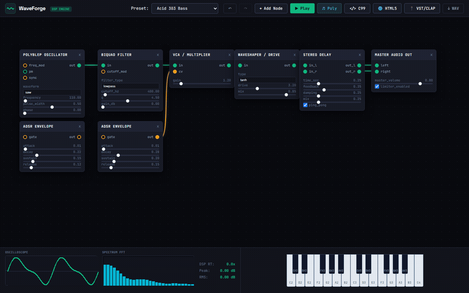
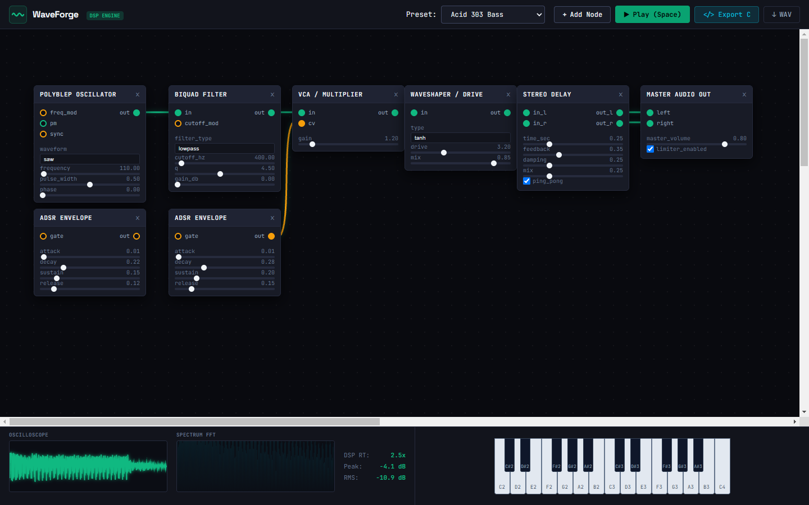
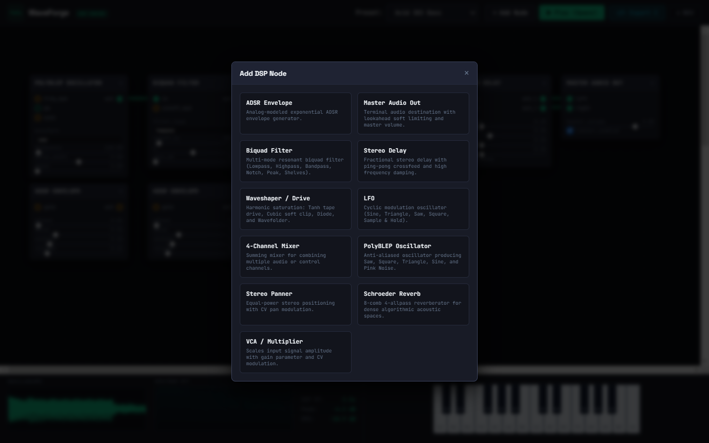
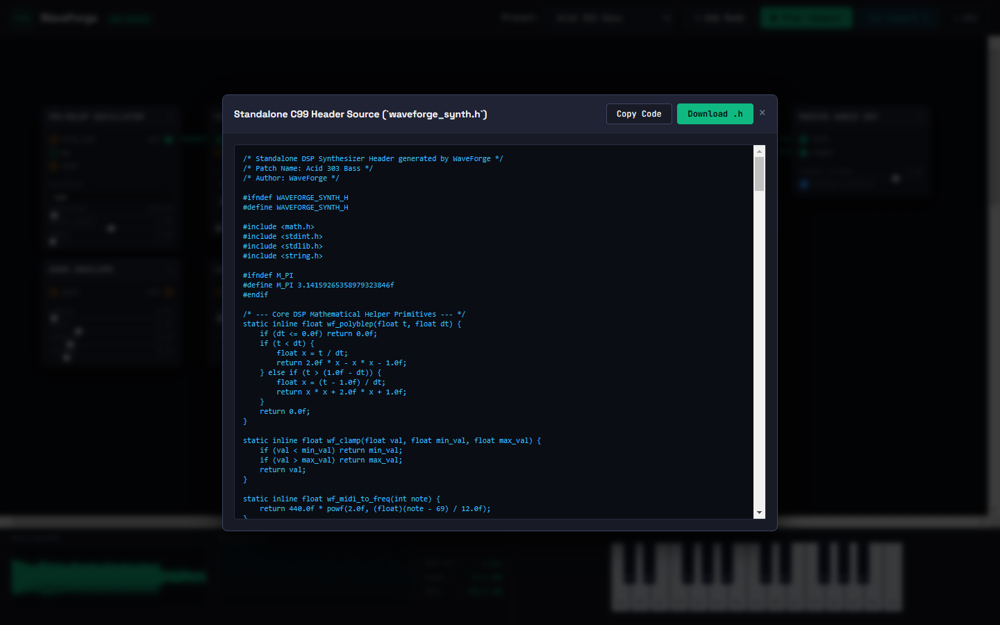

<p align="center">
  
</p>

<h1 align="center">WaveForge</h1>

<p align="center">
  Modular audio Digital Signal Processing (DSP) engine, visual node synthesizer, and zero-dependency C/WebAssembly code generator.
</p>

<p align="center">
  
</p>

## Overview

WaveForge provides a modular digital audio workstation engine in Python 3.12 with an interactive visual node patcher and an ahead-of-time C code generator. It implements mathematical filter equations without external audio frameworks.

The engine includes:
- **PolyBLEP Oscillators**: Suppresses harmonic aliasing on Sawtooth, Square (variable duty cycle), and Triangle waves via 2nd-order polynomial residuals.
- **Biquad Filters**: Robert Bristow-Johnson Audio EQ Cookbook implementations in Direct Form II Transposed (DF2T) structure for Lowpass, Highpass, Bandpass, Notch, Allpass, Peaking, and Shelving modes.
- **State Variable Filter (SVF)**: Chamberlin 2-pole filter with 2x internal oversampling, outputting lowpass, highpass, bandpass, and notch signals simultaneously.
- **Analog-Modeled Envelopes**: Exponential ADSR stages based on capacitor RC charging curves.
- **Effects Suite**: Fractional stereo ping-pong delay with Hermite interpolation, non-linear waveshaping distortion (tanh, cubic, diode, wavefolder), and Schroeder-Moorer reverberation.
- **C99 Code Generator**: Compiles any visual node graph into a single standalone C header (`waveforge_synth.h`) with zero third-party dependencies, ready to compile to native binaries or WebAssembly.

---

## Visual Studio & Architecture

<p align="center">
  
  
</p>

<p align="center">
  
</p>

---

## Installation

```bash
git clone https://github.com/alexandrmotologa/waveforge.git
cd waveforge
python -m pip install -e .
```

Requirements: Python 3.10+ (tested on Python 3.12). A C compiler (`clang` or `gcc`) is optional for compiling generated C code to native executables.

---

## Command Line Interface

WaveForge provides a Typer-powered CLI for rendering, benchmarking, inspecting patches, and launching the Web Studio.

### Render Patch to WAV
```bash
waveforge render acid_303 -o acid.wav -d 3.0 -n C3
```

### Export Standalone C Header
```bash
waveforge export-c acid_303 -o synth.h
```

### Compile and Verify C Header with Clang
```bash
waveforge compile-c acid_303 -o synth_runner.exe
```

### Run DSP Benchmark
```bash
waveforge benchmark acid_303 -s 10.0
```

### Launch Interactive Web Studio
```bash
waveforge studio --port 8000
```
Open `http://localhost:8000` in any modern web browser to access the visual rack editor, oscilloscope, spectrum analyzer, and virtual keyboard.

---

## Standalone C99 Code Generation

WaveForge converts patch graphs into pure C99 code. The generated file requires only `<math.h>` and `<stdint.h>`.

```c
#include "waveforge_synth.h"

int main() {
    WaveForgeSynth synth;
    waveforge_synth_init(&synth, 44100.0f);

    // Trigger Note On (Middle C = MIDI 60)
    waveforge_synth_note_on(&synth, 60, 0.9f);

    float left_buffer[128];
    float right_buffer[128];
    waveforge_synth_process(&synth, left_buffer, right_buffer, 128);

    return 0;
}
```

Compile with clang or gcc:
```bash
clang -O3 -DWAVEFORGE_STANDALONE synth.h -o synth_runner.exe -lm
./synth_runner.exe
```

---

## Python API Example

```python
from waveforge.graph.patch import NodeGraph
from waveforge.graph.engine import AudioEngine
from waveforge.audio.wav_io import write_wav

# Construct a modular patch
graph = NodeGraph(name="Custom Bass", sample_rate=44100)
graph.add_node("oscillator", "osc1", params={"waveform": "saw", "frequency": 110.0})
graph.add_node("biquad_filter", "flt1", params={"filter_type": "lowpass", "cutoff_hz": 800.0, "q": 3.0})
graph.add_node("adsr", "env1", params={"attack": 0.01, "decay": 0.2, "sustain": 0.3, "release": 0.2})
graph.add_node("vca", "vca1")
graph.add_node("audio_output", "out1", params={"master_volume": 0.85})

# Wire connections
graph.connect("osc1", "out", "flt1", "in")
graph.connect("flt1", "out", "vca1", "in")
graph.connect("env1", "out", "vca1", "cv")
graph.connect("vca1", "out", "out1", "left")
graph.connect("vca1", "out", "out1", "right")

# Render audio
engine = AudioEngine(graph)
left, right = engine.render(duration_sec=2.5, midi_note=48)
write_wav("bass.wav", left, right, sample_rate=44100)
```

---

## Testing

Run the full pytest suite:

```bash
pytest -v
```

The test suite validates:
- PolyBLEP step discontinuity equations and aliasing suppression
- RBJ Biquad frequency attenuation curves and filter stability
- Analog capacitor charge/discharge curves in exponential ADSR envelopes
- Fractional delay line Hermite interpolation and Schroeder reverb decay
- DAG topological sort and cycle detection
- C code generation and native compilation via clang

---

## Documentation

- [Architecture Guide](docs/ARCHITECTURE.md)
- [DSP Mathematical Theory](docs/DSP_THEORY.md)
- [C and WebAssembly Code Generation Specification](docs/CODEGEN_SPEC.md)

---

## License

MIT License. See [LICENSE](LICENSE) for details.
